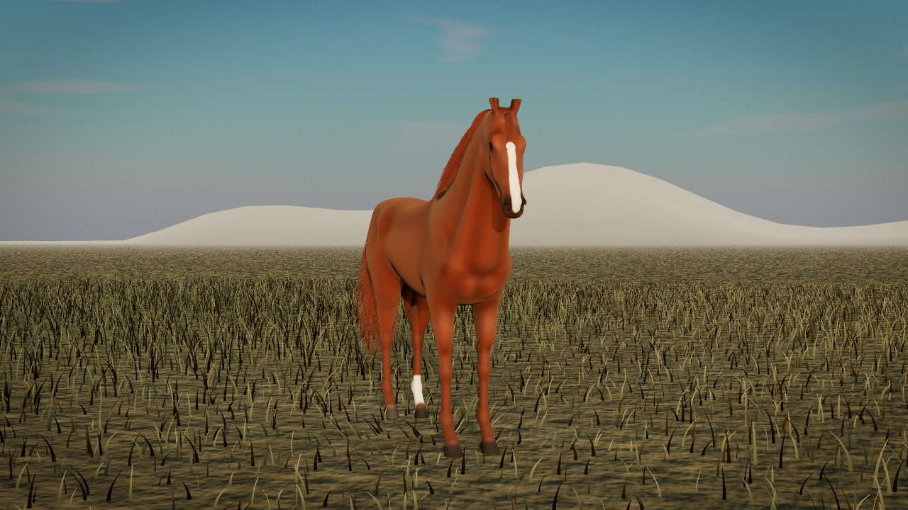
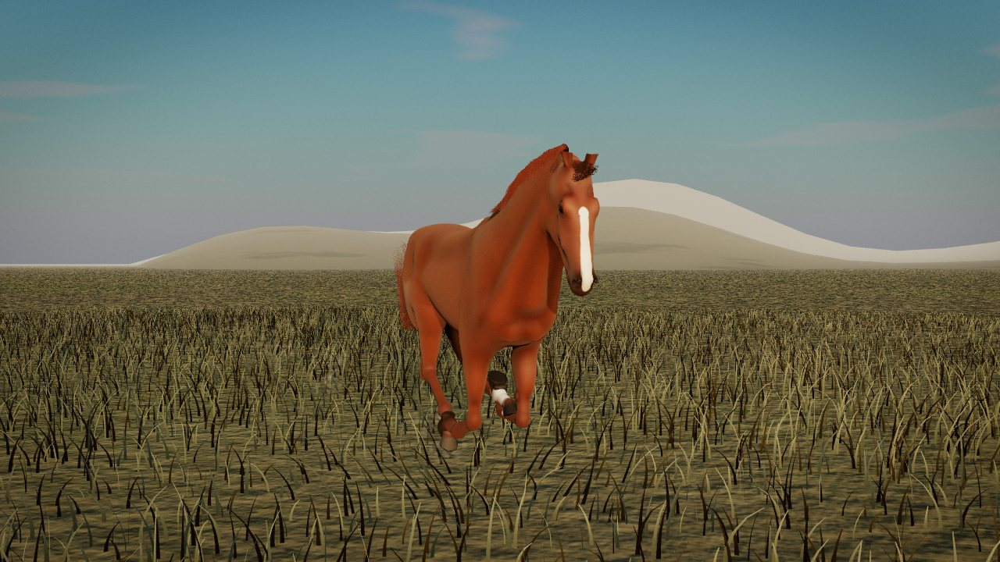
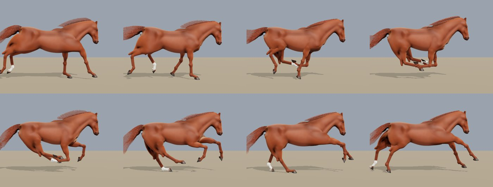

# Horse

A realistic Thoroughbred, **sculpted, rigged, groomed and animated entirely in
code**, running in the browser with three.js / WebGL2. No external meshes,
textures or motion capture are used.

**Live: https://mselin.github.io/horse/**


| | |
| --- | --- |
|  |  |

Gallop cycle (gathered → extended), procedural:



*Screenshots come from a headless software renderer (SwiftShader), with no
GPU anti-aliasing for the hair. A real GPU renders cleaner hair edges.*

## Run

```bash
npm install
npm run dev
```

Open the printed URL. The first load bakes the mesh in a Web Worker (a few
seconds). The result is cached in IndexedDB, so later loads are instant until
the sculpt changes.

`npm run build` produces a static site in `dist/`.

### Controls

| Key | Action |
| --- | --- |
| W / S (↑ / ↓) | Next / previous gait |
| 1 – 5 | Stand, walk, trot, canter, gallop |
| A / D (← / →) | Steer |
| Space | Halt |
| C | Camera: orbit / cinematic / side tracking |
| H | Hide UI |

A demo tour cycles through the gaits until you press a key. The panel has
coat colours, white markings, time of day, mesh detail and a skeleton view.

URL options: `?quality=low|medium|high`, `?coat=bay`, `?cam=cinematic`, `?nodemo`,
`?dirt=0..1`, `?sweat=0..1`. Close-up camera shots: `?cam=cinematic&shot=5` (eye),
`6` (shoulder), `7` (fore legs), `8` (hindquarters), `9` (muzzle). The orbit
camera zooms in to 30 cm.

## How it works

1. **Rig** (`src/horse/rig.js`): about 40 bones placed on anatomical landmarks
   for a 1.63 m Thoroughbred, using conformation proportions and measured
   standing joint angles.
2. **Sculpt** (`src/horse/anatomy.js`, `sdf.js`): a signed-distance sculpt
   made of
   - a lofted trunk through measured cross-sections (topline, underline,
     width), so the outline stays exact
   - about 150 anatomical forms layered on top: shoulder blade, triceps,
     pectorals, forearm extensors, biceps femoris, semitendinosus, gaskin,
     tendons, sesamoids, ergots, chestnuts, jowl, facial crest, nostrils,
     eyelids, ears with a hollow cup, and more
   - smooth CSG to combine them

   Each form carries the bones it follows, its hair-flow direction and its
   material region.
3. **Bake** (`bake.js`, `mesher.js`): Surface Nets over a sparse grid
   (7.5–12 mm), with vertices projected back onto the surface. Skin weights
   come from how much each anatomical form contributes at a vertex, then
   diffused across the surface. Hair-flow tangents, ambient occlusion and
   curvature are baked from the distance field.
4. **Coat** (`coat.js`, `FacialHairs.js`): physical material with
   - colour presets based on coat genetics, black points and white markings
     painted on the rest-pose skin
   - **hair micro-detail**: tapered hair strands, overlapping like shingles,
     scattered triplanar in skin space and oriented by the baked hair-flow
     field. Gaps between strands are darker, each strand varies in colour and
     reflects light like a cylinder. A coarser clump layer covers mid
     distances. Both fade out with distance so they never shimmer. A whorl
     sits on the forehead.
   - **veins**: the facial, jugular, spur, cephalic and saphenous veins are
     snapped onto the skin at bake time; a fine noise network covers the
     belly, inner legs and face. Both are bump-mapped and stand out more with
     exertion
   - **condition**: dust builds up on the lower legs and belly with distance
     travelled, with splatter. Sustained canter or gallop brings sweat, which
     darkens and glosses the coat and clumps the hair, plus lather between
     the hind legs, at the girth and along the neck. Sweat dries at rest
   - eyelashes, muzzle whiskers and tactile hairs over the eyes, rooted on
     the lid margin and lip skin
   - anisotropic highlights across the hair, sheen, baked occlusion and
     curvature
5. **Locomotion** (`gaits.js`, `Locomotion.js`):
   - Footfall timing, duty factors and stride frequencies come from the
     literature.
   - Each leg is a stance/swing state machine whose hooves plant in world
     space, with breakover at the end of stance.
   - Two-bone inverse kinematics run in each leg's plane, with folding
     knee, hock and fetlock in swing.
   - Body bounce, pitch and roll come from the load on each leg.
   - Back flexion, neck nod, head stabilisation, tail carriage and ear
     movement are layered on top.
6. **Mane and tail** (`Hair.js`):
   - Simulated guide strands use Verlet physics: roots are skinned to the
     body, the shape is held toward the rest pose, and wind, air drag from
     the horse's own speed, and collision spheres act on them.
   - About 21,000 rendered strands are expanded into camera-facing ribbons
     on the GPU and shaded with anisotropic highlights.
7. **World** (`src/world/World.js`):
   - physical sky with clouds and sky-based lighting
   - golden-hour sun with shadows following the horse
   - procedural ground and 70k wind-blown grass blades
   - distant hills and hoof dust
   - post-processing: bloom, warm grade, vignette and grain

See [docs/RESOURCES.md](docs/RESOURCES.md) for every reference used.

## Swapping in a professional model

The animation drives bones by name (`scap_L`, `radius_R`, `hcannon_L`, …),
using planar IK in the parent frames. A sculpted and textured horse rigged to
the same bone names and rest pose can replace the procedural mesh. The
locomotion, hair and world code stay as they are.

## Checks and publishing

`.github/workflows/ci.yml` runs on every pull request and every push to `main`:

| Job | What it checks |
| --- | --- |
| Site checks | HTML against the standard, with html-validate |
| Build and browser smoke test | `npm run build`, then `npm run test:smoke`. The smoke test loads the built site in headless Chromium with software WebGL, bakes the horse, canters, renders a frame, and fails on any page or console error |
| All checks passed | Succeeds only if every job above did. This is the check that merging requires |
| Publish the horse | On `main` only, after all checks pass: deploys `dist/` with GitHub Pages to https://mselin.github.io/horse/ |

`main` is protected by a ruleset. Every change goes in through a pull
request, and it can merge only once **All checks passed** is green. Pushing
straight to `main`, force-pushing and deleting the branch are blocked.

`preview.html` is a development page for inspecting the sculpt
(`?view=side|front|back|top|q34|head…`, `?gait=gallop&t=2`).

## Licence

Copyright (C) 2026 Mika Selin.

The horse engine and everything else in this repository, including the code, the documentation and the
screenshots in `docs/`, are free software: you can redistribute them and/or modify them under the terms of
the **GNU General Public License** as published by the Free Software Foundation, either **version 3** of
the License, or (at your option) any later version. See [`LICENSE`](LICENSE). SPDX identifier:
`GPL-3.0-or-later`.

There are no third-party assets: the horse, its coat, mane and tail, the eyes, the sky, the ground and the
grass are all generated by this code at run time. The published site bundles three.js and lil-gui, both MIT
licensed; their notices are in [`THIRD_PARTY_NOTICES.md`](THIRD_PARTY_NOTICES.md) and are published with the
site, alongside the GPL text, at `LICENSE.txt` and `THIRD_PARTY_NOTICES.txt`. The works listed in
[`docs/RESOURCES.md`](docs/RESOURCES.md) were consulted and are cited, not included.

