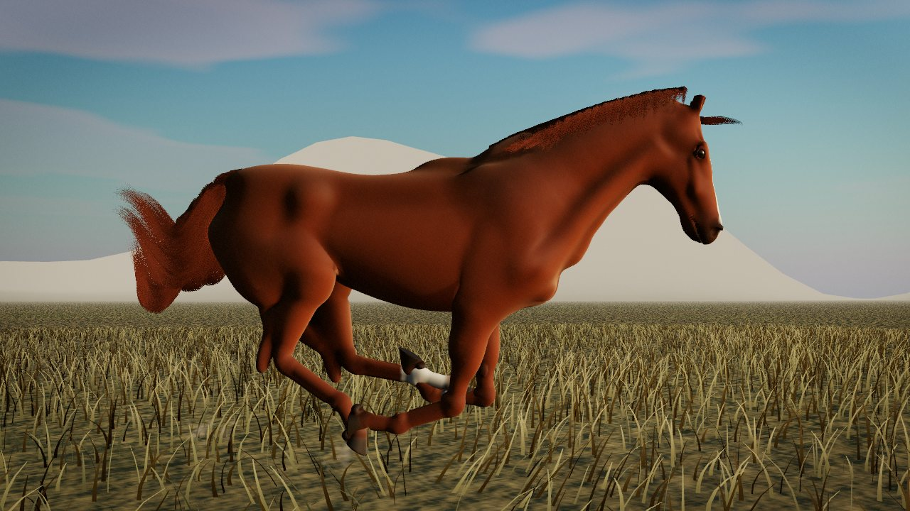

# Horse

A realistic Thoroughbred, **sculpted, rigged, groomed and animated entirely in
code**, running in the browser with three.js / WebGL2. No external meshes,
textures or motion capture are used.



| | |
| --- | --- |
|  |  |

Gallop cycle (gathered → extended), procedural:


*Screenshots come from a headless software renderer (SwiftShader), with no
GPU anti-aliasing for the hair. A real GPU renders cleaner hair edges.*

## Run

```bash
npm install
npm run dev
```

Open the printed URL. The first load bakes the mesh in a Web Worker (a few
seconds). The result is cached in IndexedDB, so later loads are instant until
the sculpt changes.

`npm run build` produces a static site in `dist/`.

### Controls

| Key | Action |
| --- | --- |
| W / S (↑ / ↓) | Next / previous gait |
| 1 – 5 | Stand, walk, trot, canter, gallop |
| A / D (← / →) | Steer |
| Space | Halt |
| C | Camera: orbit / cinematic / side tracking |
| H | Hide UI |

A demo tour cycles through the gaits until you press a key. The panel has
coat colours, white markings, time of day, mesh detail and a skeleton view.

URL options: `?quality=low|medium|high`, `?coat=bay`, `?cam=cinematic`, `?nodemo`.

## How it works

1. **Rig** (`src/horse/rig.js`): about 40 bones placed on anatomical landmarks
   for a 1.63 m Thoroughbred, using conformation proportions and measured
   standing joint angles.
2. **Sculpt** (`src/horse/anatomy.js`, `sdf.js`): a signed-distance sculpt
   made of
   - a lofted trunk through measured cross-sections (topline, underline,
     width), so the outline stays exact
   - about 150 anatomical forms layered on top: shoulder blade, triceps,
     pectorals, forearm extensors, biceps femoris, semitendinosus, gaskin,
     tendons, sesamoids, ergots, chestnuts, jowl, facial crest, nostrils,
     eyelids, ears with a hollow cup, and more
   - smooth CSG to combine them

   Each form carries the bones it follows, its hair-flow direction and its
   material region.
3. **Bake** (`bake.js`, `mesher.js`): Surface Nets over a sparse grid
   (7.5–12 mm), with vertices projected back onto the surface. Skin weights
   come from how much each anatomical form contributes at a vertex, then
   diffused across the surface. Hair-flow tangents, ambient occlusion and
   curvature are baked from the distance field.
4. **Coat** (`coat.js`): physical material with
   - colour presets based on coat genetics
   - black points and white markings painted on the rest-pose skin
   - anisotropic highlights following the hair, plus sheen
   - fine hair micro-relief and dapples
5. **Locomotion** (`gaits.js`, `Locomotion.js`):
   - Footfall timing, duty factors and stride frequencies come from the
     literature.
   - Each leg is a stance/swing state machine whose hooves plant in world
     space, with breakover at the end of stance.
   - Two-bone inverse kinematics run in each leg's plane, with folding
     knee, hock and fetlock in swing.
   - Body bounce, pitch and roll come from the load on each leg.
   - Back flexion, neck nod, head stabilisation, tail carriage and ear
     movement are layered on top.
6. **Mane and tail** (`Hair.js`):
   - Simulated guide strands use Verlet physics: roots are skinned to the
     body, the shape is held toward the rest pose, and wind, air drag from
     the horse's own speed, and collision spheres act on them.
   - About 21,000 rendered strands are expanded into camera-facing ribbons
     on the GPU and shaded with anisotropic highlights.
7. **World** (`src/world/World.js`):
   - physical sky with clouds and sky-based lighting
   - golden-hour sun with shadows following the horse
   - procedural ground and 70k wind-blown grass blades
   - distant hills and hoof dust
   - post-processing: bloom, warm grade, vignette and grain

See [docs/RESOURCES.md](docs/RESOURCES.md) for every reference used.

## Swapping in a professional model

The animation drives bones by name (`scap_L`, `radius_R`, `hcannon_L`, …),
using planar IK in the parent frames. A sculpted and textured horse rigged to
the same bone names and rest pose can replace the procedural mesh. The
locomotion, hair and world code stay as they are.

`preview.html` is a development page for inspecting the sculpt
(`?view=side|front|back|top|q34|head…`, `?gait=gallop&t=2`).
